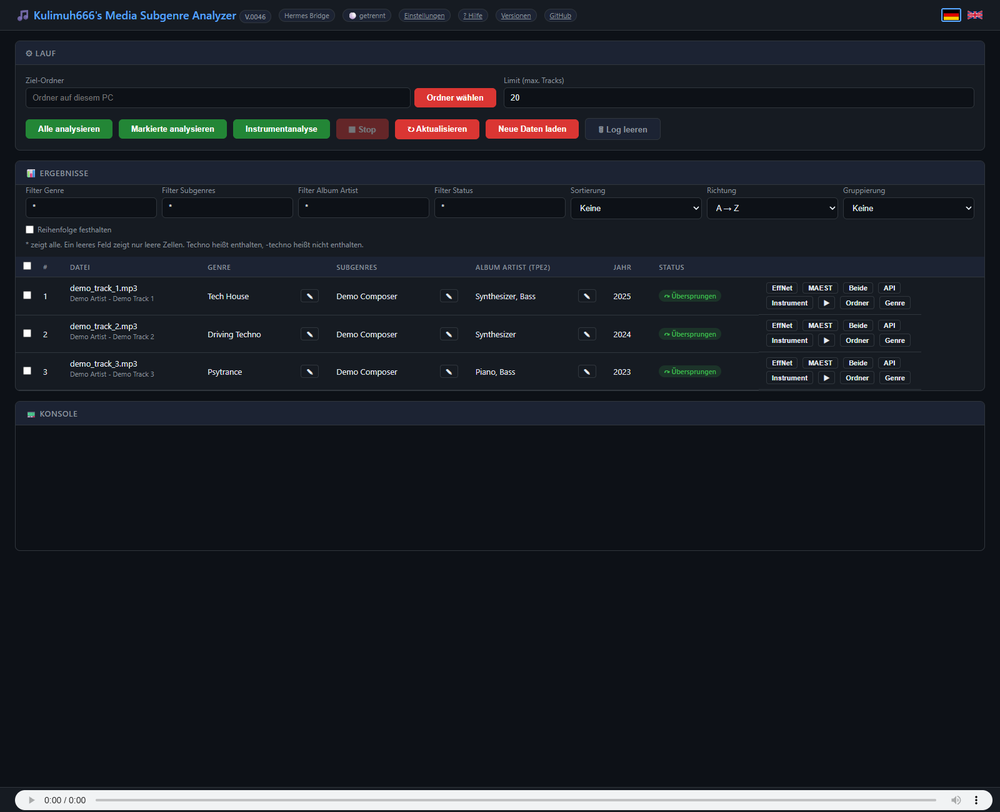
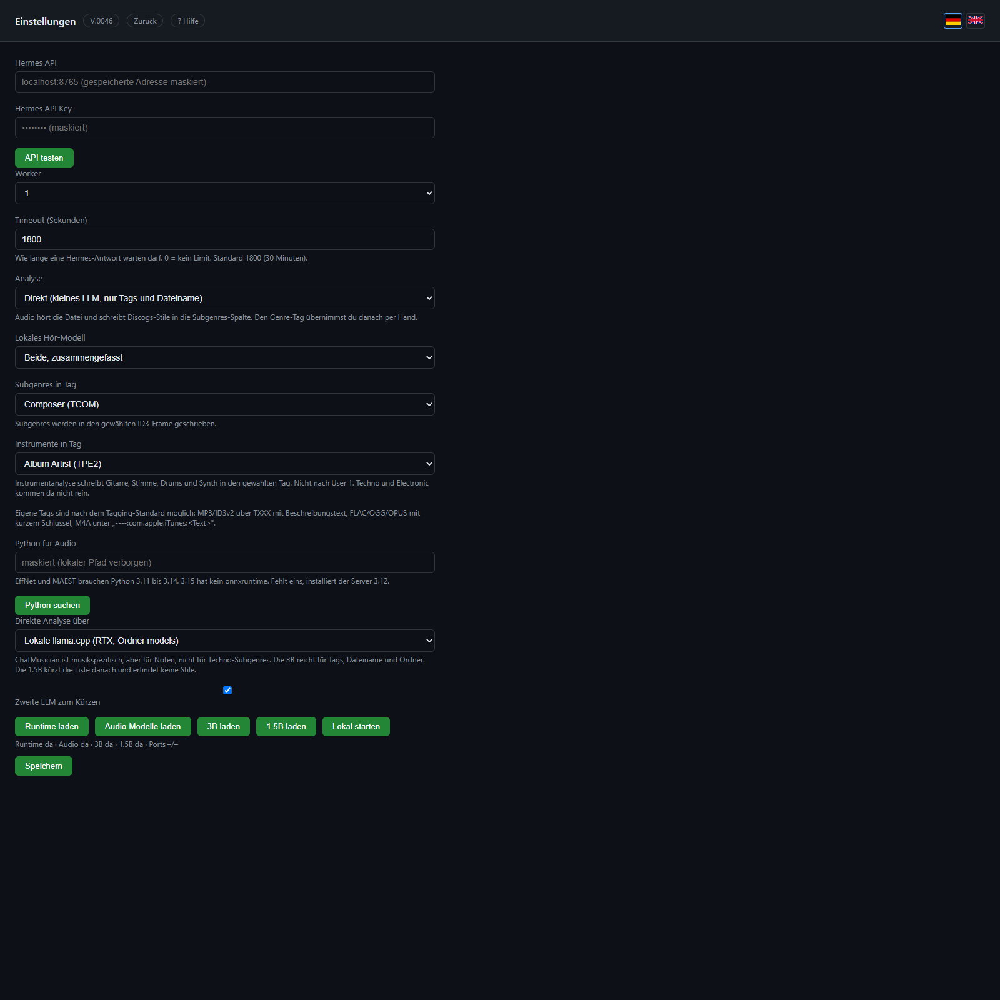

# Kulimuh666's Media Subgenre Analyzer

[Deutsch](#deutsch) · [English](#english)

---

## Deutsch

Schreibt Subgenres und das Jahr in Audio-Dateien. Die Dateien bleiben auf dem PC, der `start_gui.bat` startet. Hermes liefert nur die Einschätzung. Instrumente gehen nach Album Artist (TPE2), nicht nach User 1.

### Screenshots

**Werkzeug-Oberfläche (GUI)** — Screenshot auf Grundlage vereinfachter Demo-Daten (keine echten Tracks/Artists/Pfade: Ziel-Ordner und Log sind aus Platzgründen geleert; die drei Zeilen sind fiktive Demo-Tracks):

**Einstellungen-Seite** — Screenshot mit maskierten Schlüsseln (hermes_url, api_key, pythonPath) und ohne Werte; nur Struktur und Buttons sind sichtbar:

### Was welcher Button macht

Die **ERGEBNISSE-Queryzeile = Row** (Filter- und Sortier-Leiste + Tabellenzeilen) beschreibt alles in der Ergebnis-Ansicht — den Filter-/Sortierkopf und die Ein-Zeile-pro-Track-Zeilen.

#### Kopfzeile
| Element | Funktion |
|---|---|
| Einstellungen | öffnet die Einstellungen (`settings.html`) |
| Hilfe (?) | öffnet die Hilfe (`hilfe.html`) |
| Versionen | öffnet die Versionshistorie (`versionen.html`) |
| GitHub | öffnet das Repository |
| DE / EN (Flags) | wechselt UI-Sprache (Deutsch ↔ English) |
| Versions- / Hermes-Bridge-Badge | zeigt Version und Verbindungsstatus der Hermes-Bridge (getrennt/verbunden) |

#### LAUF-Panel (links oben)
| Element | Funktion |
|---|---|
| Ziel-Ordner (Input) | der Ordner mit den Audio-Dateien |
| Ordner wählen | native Folder-Picker — setzt den Ordner und lädt die Dateien |
| Limit (max. Tracks) | max. Anzahl geladener Dateien |
| Alle analysieren | analysiert alle sichtbaren Tracks |
| Markierte analysieren | analysiert nur die markierten Zeilen (Checkbox) |
| Instrumentanalyse | hört alle sichtbaren Dateien und schreibt die Instrumente nach Album Artist (TPE2) |
| Stop | stoppt eine laufende Analyse |
| Aktualisieren | lädt Config neu und aktualisiert die Zeilen |
| Neue Daten laden | erzwingt eine Neuladung der Trackliste (Rescan) |
| Log leeren | leert die Konsole |

#### Queryzeile = Row (Filter- und Sortier-Leiste + Tabellenzeilen)
| Element | Funktion |
|---|---|
| Filter Genre / Subgenres / Album Artist / Status | `*` zeigt alle, leeres Feld nur leere Zellen; Techno enthält, `-techno` schließt aus (inkl. Peak Time Techno / Driving Techno / Psytrance) |
| Sortierung | Keine / Datei / Genre / Subgenres / Album Artist / Jahr / Status |
| Richtung | A → Z (aufsteigend) / Z → A (absteigend) |
| Reihenfolge festhalten | friert die aktuelle Sortierung ein, statt sie bei jeder Auto-Aktualisierung neu zu mischen |
| Checkbox | Auswahl für „Markierte analysieren" |
| # | Zeilennummer (sortiert) |
| DATEI | Dateiname (Hover: voller Pfad) |
| GENRE / SUBGENRES / ALBUM ARTIST / JAHR | ID3-Zellen — ✏️ Stift-Button öffnet das Bearbeiten-Modal für die Zelle |
| STATUS | Status-Badge (z. B. „Überspringen" = fertiger Track, „Wartend" = noch zu analysieren) |
| EffNet | analysiert den Track mit dem lokalen EffNet-Modell (Genre) |
| MAEST | analysiert mit dem lokalen MAEST-Modell (Genre) |
| Beide | EffNet + MAEST, zusammengefasst |
| API | sendet den Track an den Hermes-API (LLM-Einschätzung, schreibt Jahr/Subgenres) |
| Instrument | per-Track Instrumentanalyse → schreibt nach Album Artist (TPE2) |
| ▶ / Ordner / Genre | ▶️ Track abspielen · 📁 in Dateimanager zeigen · ✏️ Subgenre-Bearbeiten öffnen |

#### Konsole
Zeigt die Aktivität des Backends (Config-Load, Trackliste, Analyse).

#### Player-Leiste (unten)
| Element | Funktion |
|---|---|
| ▶️ | Play/Pause |
| Zeit + Fortschrittsbalken | Position anzeigen / springen |
| Lautsprecher | Mute/Lautstärke |
| ⋯ | Player-Optionen |

#### Einstellungen-Seite
| Element | Funktion |
|---|---|
| Hermes-API-Adresse + API-Key | Ziel des LLM |
| Worker | max. parallele Analysen (1/2/3/5) |
| Timeout | maximale Wartezeit auf die Hermes-Antwort |
| Modus | Websuche / Direkt (kleines LLM, nur Tags + Dateiname) / Audio (hört Datei) |
| Lokales Hör-Modell | EffNet / MAEST / Beide, zusammengefasst |
| Subgenres in Tag | Ziel-Tag für Subgenres (Composer TCOM / Genre TCON / Artist TPE1 / Album Artist TPE2 / Conductor TPE3 / Title TIT2 / TIT1 / Album TALB / Custom TXXX) |
| Instrumente in Tag | Ziel-Tag für Instrumente (identisch) |
| Python für Audio + Python suchen | Python-Interpreter mit mutagen (z. B. 3.11–3.14) |
| Direkte Analyse über + Modelle | Hermes (API) / lokale llama.cpp (RTX, models/) + 3B / 1.5B / Audio-Modelle |
| Zweite LLM zum Kürzen (Checkbox) | separate Zusammenfassung |
| Runtime laden | lädt die lokale llama.cpp-Engine |
| Audio-Modelle laden | lädt EffNet/MAEST (.npz) |
| 3B laden / 1.5B laden | lädt das jeweilige LLM-Modell |
| Lokal starten | startet den lokalen llama.cpp-Server |
| API testen | testet die Hermes-Verbindung |
| Speichern | speichert die Einstellungen |
| Hilfe (?) | öffnet die Hilfe |
| DE / EN (Flags) | UI-Sprache |

### Einrichten
`config.example.json` nach `config.json` kopieren und Key sowie Zielordner eintragen. Modelle liegen lokal in `models/` und sind nicht im Zip. Release-Zip und Git ohne Key, LAN-Adresse, Benutzerpfade, Modelle, Musik oder `config.json`.

## English

Writes subgenres and the year into audio files. Files stay on the PC that starts `start_gui.bat`. Hermes only returns the judgement. Instruments go to album artist (TPE2).

### Screenshots
Same screenshots as the German section above — GUI screenshot uses fictional demo data (target folder and log are blanked), settings screenshot masks secrets.

### What each button does

The **results query row = Row** (filter/sort bar + per-track row table) describes everything in the results view — the filter/sort header and the one-row-per-track table.

#### Header
| Element | Function |
|---|---|
| Settings (Einstellungen) | opens the settings (`settings.html`) |
| Help (?) | opens the help (`hilfe.html`) |
| Versionen | opens the version history (`versionen.html`) |
| GitHub | opens the repository |
| DE / EN (Flags) | switches UI language (Deutsch ↔ English) |
| Version / Hermes-Bridge badge | shows version and connection status of the Hermes bridge (disconnected/connected) |

#### LAUF panel (top left)
| Element | Function |
|---|---|
| Ziel-Ordner (target folder, input) | the folder with audio files |
| Ordner wählen | native folder picker — sets the folder and loads the files |
| Limit (max. tracks) | max. number of loaded files |
| Alle analysieren | analyses all visible tracks |
| Markierte analysieren | analyses only the checked rows (checkbox) |
| Instrumentanalyse | listens to all visible files and writes the instruments to album artist (TPE2) |
| Stop | stops a running analysis |
| Aktualisieren | reloads the config and updates the rows |
| Neue Daten laden | forces a reload of the track list (rescan) |
| Log leeren | clears the console |

#### Query row = Row (filter/sort bar + per-track row table)
| Element | Function |
|---|---|
| Filter Genre / Subgenres / Album Artist / Status | `*` shows all, empty field only empty cells; `Techno` includes, `-techno` excludes (incl. Peak Time Techno / Driving Techno / Psytrance) |
| Sortierung | Keine / Datei / Genre / Subgenres / Album Artist / Jahr / Status |
| Richtung | A → Z (ascending) / Z → A (descending) |
| Reihenfolge festhalten | freezes the current sort instead of re-mixing it on every auto-update |
| Checkbox | selection for "Markierte analysieren" |
| # | row number (sorted) |
| DATEI | file name (hover: full path) |
| GENRE / SUBGENRES / ALBUM ARTIST / JAHR | ID3 cells — ✏️ pencil button opens the edit modal for the cell |
| STATUS | status badge (e.g. "Überspringen" = finished track, "Wartend" = still to analyze) |
| EffNet | analyzes the track with the local EffNet model (genre) |
| MAEST | analyzes with the local MAEST model (genre) |
| Beide | EffNet + MAEST, combined |
| API | sends the track to the Hermes API (LLM judgement, writes year/subgenres) |
| Instrument | per-track instrument analysis → writes to album artist (TPE2) |
| ▶ / Ordner / Genre | ▶️ play track · 📁 reveal in file manager · ✏️ open subgenre edit |

#### Console
Shows backend activity (config load, track list, analysis).

#### Player bar (bottom)
| Element | Function |
|---|---|
| ▶️ | Play/pause |
| Time + progress bar | shows/jumps position |
| Speaker | mute/volume |
| ⋯ | player options |

#### Settings page
| Element | Function |
|---|---|
| Hermes-API address + API key | destination of the LLM |
| Worker | max. parallel analyses (1/2/3/5) |
| Timeout | max. wait time for the Hermes response |
| Modus | Websuche / Direkt (small LLM, only tags + file name) / Audio (listens to the file) |
| Lokales Hör-Modell | EffNet / MAEST / Beide, combined |
| Subgenres in Tag | target tag for subgenres (Composer TCOM / Genre TCON / Artist TPE1 / Album Artist TPE2 / Conductor TPE3 / Title TIT2 / TIT1 / Album TALB / Custom TXXX) |
| Instrumente in Tag | target tag for instruments (identical) |
| Python für Audio + Python suchen | Python interpreter with mutagen (e.g. 3.11–3.14) |
| Direkte Analyse über + Modelle | Hermes (API) / local llama.cpp (RTX, models/) + 3B / 1.5B / Audio-Modelle |
| Zweite LLM zum Kürzen (Checkbox) | separate summarization |
| Runtime laden | loads the local llama.cpp engine |
| Audio-Modelle laden | loads EffNet/MAEST (.npz) |
| 3B laden / 1.5B laden | loads the respective LLM model |
| Lokal starten | starts the local llama.cpp server |
| API testen | tests the Hermes connection |
| Speichern | saves the settings |
| Hilfe (?) | opens the help |
| DE / EN (Flags) | UI language |

### Setup
Copy `config.example.json` to `config.json` and fill in the key and target folder. Models live locally in `models/` and are not in the zip. Release zip and git without key, LAN address, user paths, models, music, or `config.json`.
